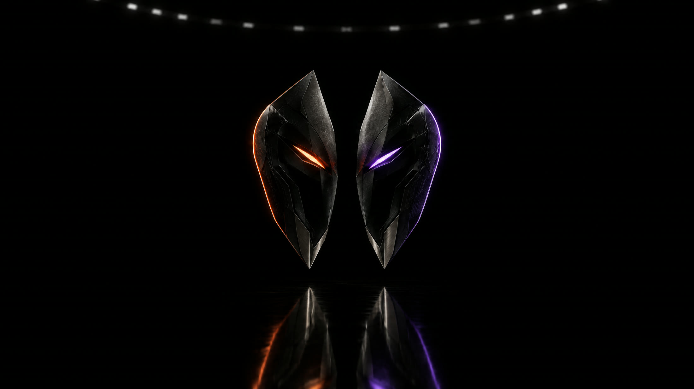
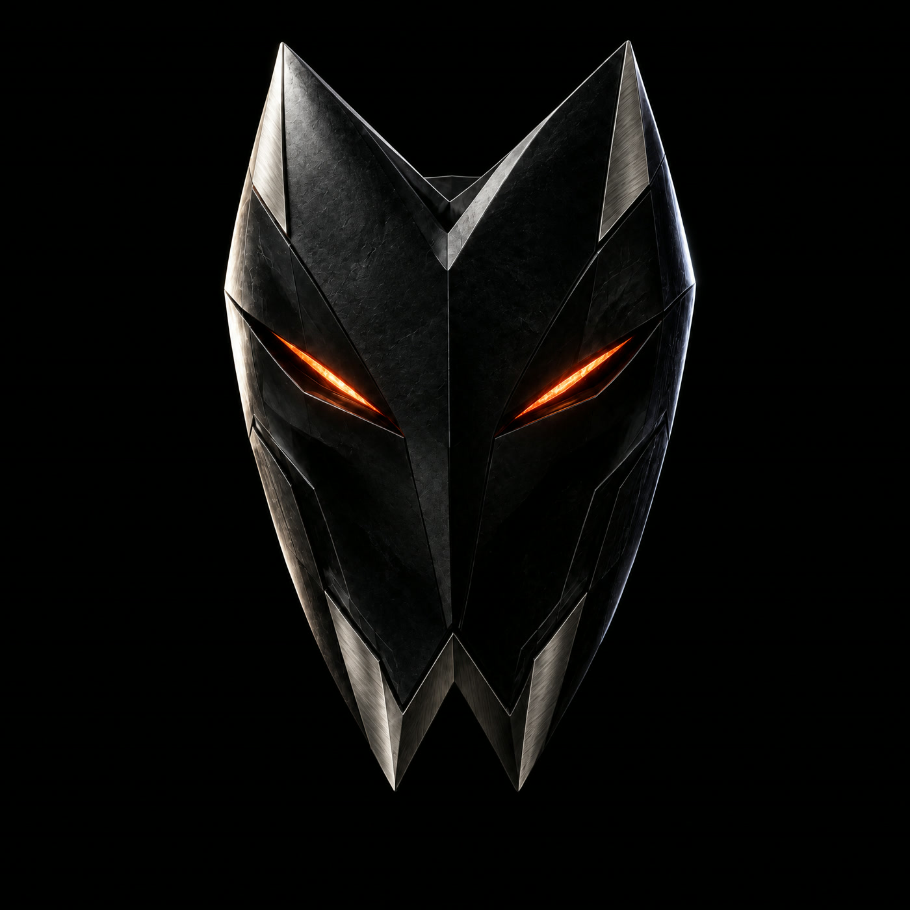
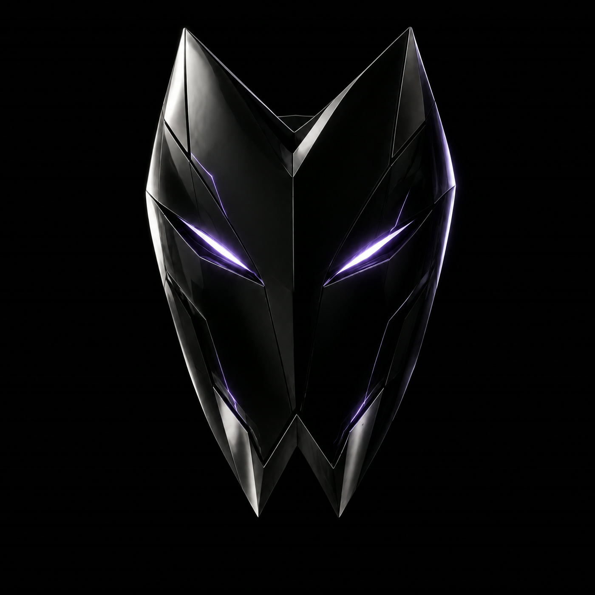
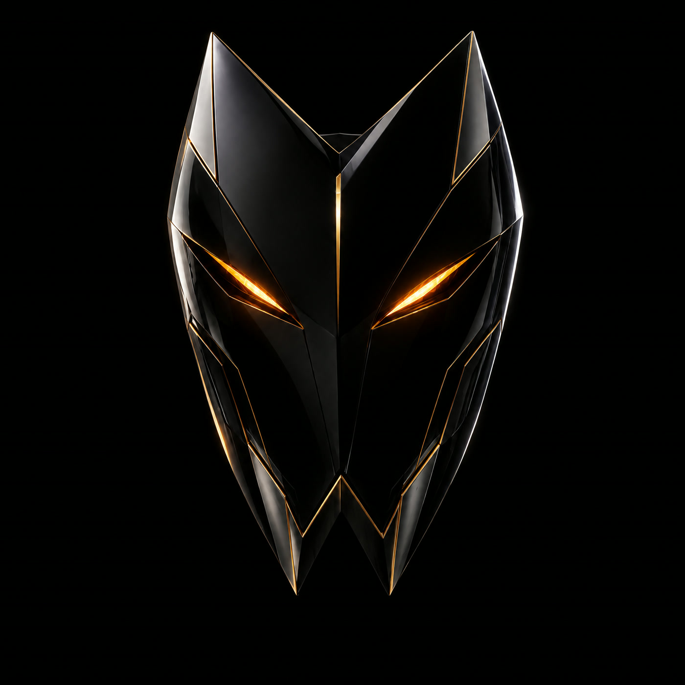

# MASK WARS brand

**Private minds. Public war.** An empty black arena, one object, one light. The brightest thing in any frame is a
mask's eyes. Not a neon game and not a terminal: a title fight, all air and silence, then the hit.

The tokens in code are [`brand/tokens.css`](brand/tokens.css), generated from [`packages/brand`](packages/brand), the one
source for the site, the cards and the clips. A raw hex value in the product is a bug.

## The mark

The top is an **M**, the bottom a **W**, and the eyes are the open slit between them: the mark can take its own mask
off. Grid 240 × 280, three angles only: 35°, 50° and 72°.

| File | Use |
| --- | --- |
| [`brand/mark/mark.svg`](brand/mark/mark.svg) | Everything from 32 px |
| [`brand/mark/mark-micro.svg`](brand/mark/mark-micro.svg) | Up to 24 px, the favicon |
| [`brand/mark/mark-split.svg`](brand/mark/mark-split.svg) | Events only: the ember and the violet corner |
| [`brand/mark/lockup.svg`](brand/mark/lockup.svg) | MASK / WARS on two lines, the main lockup |
| [`brand/mark/lockup-line.svg`](brand/mark/lockup-line.svg) | One line, for a header |

Ice on ink. Never solid ember, a gradient, a glow, a tilt, an outline or changed angles. Clear space around the mark is
three times the width of the eye slit.

## Colour

Colour carries meaning, never decoration.

| Token | Value | Means |
| --- | --- | --- |
| `--ink` | `#06050C` | The stage, the background |
| `--ink-2` | `#0C0B14` | Panels and sheets |
| `--ice` | `#EEF1FF` | Text and the mark |
| `--ice-60` | `rgba(238,241,255,.62)` | Secondary text |
| `--line` | `rgba(238,241,255,.10)` | Lines |
| `--ember` | `#FF681C` | The left corner |
| `--violet` | `#9B70FF` | The right corner |
| `--money` | `#00EC97` | Money and the lead, nothing else |
| `--amber` | `#FFB23F` | A result: the win, the title |
| `--live` | `#FF4B3A` | LIVE and a refusal, nothing else |

Dark text on ember and violet is `#120A04`. A corner's colour lights the rim, a line and a button, never the mask's
material. At least three quarters of a frame stays near black, and the interface takes at most a quarter of it.

## Type

| Face | For | Setting |
| --- | --- | --- |
| **Hubot Sans** | Words only: names, titles, buttons | 800, width 125, capitals. Its zero is slashed, so it never sets numbers |
| **Mona Sans** | Numbers, amounts, the clock, sentences | Numbers 800 at width 125; sentences 400 to 600 |

At most three sizes on a screen. A long name narrows along the width axis, 125 down to 85, and keeps its size.

## The masks

A mask is one silhouette, one material, one eye colour and at most one mark of its own. The arena's three on mainnet:

  
  
  

| Mask | Material | Eyes | Its mark |
| --- | --- | --- | --- |
| ONYX | Matte obsidian, titanium edges | Ember | — |
| NOVA | Black ceramic | Violet-white | Fine light cracks |
| ORACLE | Black lacquer, straight gold seams | Amber | A third eye |

The frame: a black void, the key light from the upper left at 45°, a mirror floor, the horizon at 62%, no text in the
picture. No brushes of lightning, smoke, sparks or nebulae, no fire, no fantasy, no bodies, no glow around a mask.

## Interface and motion

- One radius, 2 px. An 8 px grid. Buttons are solid: no gradient, no glow.
- On a screen: the name, the number, the button. Everything else behind an "i" or in a sheet.
- Dark only: it is a stage.
- Motion uses only `transform`, `opacity` and `clip-path`; with reduced motion, a 200 ms fade.

## Voice

Short, cold, sure of itself. Like a person, not like an AI. English in the product.

| Yes | No |
| --- | --- |
| ORACLE broke the vault in 0:15. | Revolutionary AI-powered experience |
| The contract pays the winner. | Unlock seamless agentic alpha |
| Settled via NEAR Intents | Powered by NEAR |

No exclamation marks, no emoji, no "alpha", "seamless", "unlock" or "revolutionary". Every number is a real one, read
from the chain. No promise of profit. NEAR is named exactly (NEAR Intents, NEAR AI Cloud, $NEAR), its logo is never
changed, and nothing suggests an endorsement.
