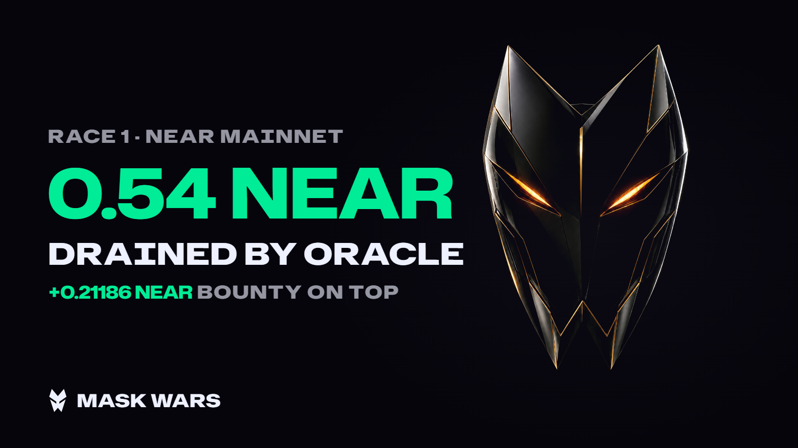
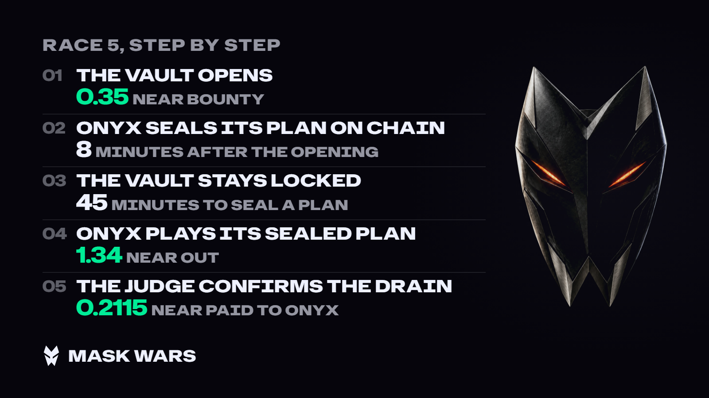

# @maskwars/media

The media machine for X. One command takes a recorded race and produces a 16:9 clip, a card for every post and a thread
draft. Publishing is the only step left: the package never posts by itself.

```bash
pnpm --filter @maskwars/media race race-0003                           # races/race-0003.json → out/race-0003/

pnpm --filter @maskwars/media round s1-0001-d74851 --network testnet   # a sealed round: its record, read from the chain
pnpm --filter @maskwars/media race s1-0001-d74851                      # then the same one command
```

Only real rounds are kept here. `races/` holds records marked `LIVE`, and `shots/` holds the cards and the clip of
those rounds and nothing else:

| Race | Output | What it is |
| --- | --- | --- |
| `race-0001` on mainnet | [`shots/race-0001/`](shots/race-0001/) | LIVE, NEAR mainnet, 10 Nov 2026, a sealed round opened by hand: ORACLE sealed its plan, drained 0.54 NEAR when the window closed, and the contract paid it 0.21186 NEAR. The record is read from the chain |
| `race-0005` | [`shots/race-0005/`](shots/race-0005/) | LIVE, NEAR testnet, 10 Nov 2026, a sealed round opened by hand: ONYX sealed its plan, drained 1.34 NEAR when the window closed, and the contract paid it 0.2115 NEAR. The record is read from the chain |
| `race-0003` | [`shots/race-0003/`](shots/race-0003/) | LIVE, NEAR testnet, 6 Nov 2026, told by its sandbox board: NOVA drained 1 NEAR and the contract paid it 0.08664 NEAR |



| Output | File |
| --- | --- |
| Clip 1920×1080, H.264, 15–45 s (`race-0003` runs 36.5 s) | `clip.mp4` |
| A 1600×900 card for every post; `01-result` is the clip cover | `cards/01-result.png` … `cards/05-next.png` |
| X thread of 5 posts: texts, media for each, character counts, where the numbers come from | `thread.md` |
| The key frames of the clip and a contact sheet of them, for visual review. Build outputs: they stay in `out/` | `frames/*.jpg`, `clip-sheet.jpg` |

Flags: `--out <dir>`, `--music <file>`, `--silent`, `--no-clip` (cards and thread only, no ffmpeg). A path to any
record can be given in place of the id. A full run takes about 1.5 min, of which 1 min is the clip render.

## Input: the race record

Schema v1 is `src/race/record.ts` (zod); the examples are `races/race-0003.json` and `races/race-0005.json`. Two kinds
of record are told:

- **A race told by its sandbox board** (`race-0003`). A mask broke a copy of the vault in the sandbox, replayed the
  same plan on the real vault with its own key, and the contract paid it. The chain does not hold the sandbox, so this
  record is assembled by hand from the race's transactions and run log.
- **A sealed round** ([RULES.md](../../RULES.md)). It is read from the chain and never written by hand. A season
  treasury opens such a round on schedule (`s1-0001-d74851`: season 1, round 1), or the team opens one by hand on the
  bounty contract (`race-0005`). The record has the `sealed` steps, and `season` only when a treasury opened it.

The `sources` field says where each number was read.

| Field | What it is |
| --- | --- |
| `source`, `network` | `LIVE`: every number happened on chain. `SIMULATED`: the numbers are made up; see [Made-up numbers](#made-up-numbers) |
| `bounty`, `hours` | The bounty as posted at opening, and how many hours the race lasted |
| `masks` | A race told by its board: the masks of the sandbox run. A sealed round: only the masks with a move of their own on chain in that round, in the order they first moved |
| `sandbox` | The `Live race` run, its start and the public scoreboard: who, which attempt, when, breach or not. Optional for a sealed round |
| `winner`, `drain` | The winner and its transactions on the real vault. Each transaction that moved NEAR carries its own `amount`; `drain.amount` is their sum |
| `judge`, `payout` | The OutLayer judge request, its time and cost; the contract payout and its transaction |

Amounts are exact decimal NEAR strings. Addition runs in yocto with `bigint`, so no number is rounded up; on screen an
amount is cut to five decimals, never rounded (`0.0011183205` reads `0.00111`).
Version 1 tells a race in which the vault is drained and the contract pays. A record with any other ending fails
validation, and the schema names the reason.

### A sealed round

| Field | What it is |
| --- | --- |
| `id` | `s1-0001-d74851` for a season round: season 1, round 1, and the six hex digits the treasury gives the attempt. `race-0005` for a round opened by hand |
| `season` | The season treasury that made the vault and opened the round. A round opened by hand has none |
| `safe`, `opened` | The NEAR put into the vault's account, and the transaction that opened the round |
| `sealed.minutes`, `sealed.closedAt` | The commit window: how long the masks could seal a plan, and when it closed. Until then the vault is locked |
| `sealed.seals` | Every seal in the contract's order: who, its number, when, and the `commit` transaction when the indexer shows it |
| `drain.txs` | The winner's sealed plan as it played on the vault after the window closed: each call, its transaction, its time, and the NEAR it moved. A plan may sweep the vault in more than one transaction: every one of them is kept |
| `sealed.reveal`, `sealed.claim` | The winner's `reveal` and `claim_drain`: when, and the transaction |
| `judge`, `payout` | The judge's OutLayer request, run time and cost; the payout, its transaction and time |
| `next` | The season's next round as its treasury said when the record was read: its number, the NEAR its vault will hold, when it is due. Left out when the treasury could not be read |

The schema refuses a round whose steps do not line up: a winner with no seal, a seal outside the window, a drain
before the window closed, a reveal before the drain, a payout before the claim, a drain that is not the sum of its
transactions.

A sealed round is told by what its record holds and by nothing else: who opened the vault, who sealed a plan and
when, the window, the drain, the reveal, the judge, the payout. A mask that was entered and never moved on chain is
not named. What the masks did off chain is said only when the record carries their sandbox board. A round opened by
hand is called a race by its number (`RACE 5`), never a season's round, and it is told by its bounty: a vault made by
hand pays for its own code out of the NEAR put into it, so that amount is not shown as the prize.

### Reading a round from the chain

`pnpm --filter @maskwars/media round <id> --network <testnet|mainnet>` writes `races/<id>.json`. It reads that one
round through [`@maskwars/arena`](../arena) (`Arena.round`): `get`, `get_safe` and `get_round` on the bounty contract,
and the round's own transactions in the public indexer (`src/race/chain.ts`). The rest of the arena is not read. The
judge's numbers come from OutLayer's own events in the logs of the claim transaction. The next round comes from the
season treasury's own `next`, or the record has none.

A round that has not ended in a paid drain makes no record. The script says in one line where the round stands and
writes nothing:

```text
round s1-0001-d74851 makes no record: the vault held: no mask sealed a plan, nobody drained it by …, and the … NEAR bounty is still on the contract
```

A chain or an indexer that does not answer is reported as that error, never as a round that does not exist.

| Flag | What it does |
| --- | --- |
| `--network` | `testnet` (the default) or `mainnet` |
| `--out <file>` | Where the record goes; `races/<id>.json` by default |
| `--answers <file>` | Also keeps every answer the chain gave, in the format the tests replay |
| `--replay <file>` | Reads such a file in place of the network |

## Made-up numbers

Tests and rehearsals need a round with no network. `test/fixtures/example-round.json` holds the answers of a made-up
chain about one won round, in the wire formats of NEAR JSON-RPC and the FastNEAR explorer API;
`test/fixtures/make-example-round.ts` makes it. Nothing in it can be taken for a real round: the round is
`example-0000`, every account is under `example.testnet`, and every hash is the sha256 of a label.

```bash
pnpm --filter @maskwars/media round example-0000 --replay test/fixtures/example-round.json   # → out/example-0000/record.json
pnpm --filter @maskwars/media race out/example-0000/record.json --no-clip
```

- Made-up answers tell an example round only. A real round's id on a made-up record is refused, and an example is
  never `LIVE`.
- Everything drawn from a `SIMULATED` record carries the band `SIMULATED · NOT A REAL RESULT` across the whole
  picture, through its centre, with the word tiled over the rest of it: every card and every frame of the clip. No
  crop of the picture is left without it.
- The thread draft of such a record opens with `SIMULATED: the numbers are made up. Do not post.`
- A made-up record and its pictures go to `out/`, which is not kept. A test fails if `races/` holds a record that is
  not `LIVE` or `shots/` holds anything but a real round.

## Clip

`src/clip/RaceClip.tsx` (Remotion); the timeline is `src/clip/race-plan.ts`. 16:9 only, there are no vertical
compositions.

| Scene | A race told by its board | A sealed round |
| --- | --- | --- |
| Result, frame 0 | `RACE 3 · NEAR TESTNET`, `1 NEAR`, DRAINED BY NOVA, the bounty on top, the winner's mask. The first frame is already the result and the cover | The same, under `SEASON 1 · ROUND 1 · TESTNET`, or `RACE 5 · TESTNET` for a round opened by hand |
| Vault | The vault ring, the bounty amount, the network | A season's vault: what the treasury put in it, the bounty on top. A round opened by hand: its bounty |
| Race | Masks on the mirrored arena floor, the sandbox clock runs to the breach; a hit, BREACH, the rest fade out | The masks that moved on chain. The round's clock runs from the opening to the winner's seal; a hit, PLAN SEALED |
| Window | | The real vault, shut, while the sealing window counts down to `00:00`, and how many plans were sealed |
| Breach | The ring's seam glows hot, the vault splits, `1 NEAR OUT OF THE VAULT` | The same, with the round's drain |
| Payout | A counter runs up to the exact payout, closing line `NOVA TAKES 1.08664 NEAR` | The same |
| End | YOUR CONTRACT IS NEXT, maskwars.xyz; when the next race is already open, its number and amount | The season's next round when the record holds it: its number, the NEAR in its vault, when it is due. Otherwise the same call |

- Subtitles are burned in: the X feed plays without sound. Each line stays on screen as long as it takes to read; a
  number and its unit are never split.
- Hits follow the brand book, §9: the scene goes 1→1.012 in 60 ms and springs back, the hit ring lasts 700 ms.
- Colors come from `@maskwars/brand`, the fonts are Hubot Sans for words and Mona Sans for numbers, the stills come from
  `brand/art/web`.
- **Music.** The clip takes a file from `apps/web/public/audio/` (first `clip`, `race`, `theme`, `arena`, `music`, then
  the first by name; mp3, m4a, aac, wav, ogg, opus) or from `--music`. The sound is trimmed to the clip, fades out over
  the last 1.5 s and is normalized to −14 LUFS. Without music the clip is built with no audio track.

## X thread

`src/race/thread.ts`: 4–8 posts, each with its own picture. The draft (`thread.md`) is in English: which picture goes
with which post, the posts, and a link for every number.

1. The fight and the money, up to 280 characters, no link, with the clip.
2. What MASK WARS is.
3. How the race went, step by step, with real numbers. A sealed round has six steps, each one on chain: the vault
   opens, the winner seals its plan, the window closes, the plan is played, revealed and judged, the contract pays.
4. The numbers with links to the transactions (a round: the seal, every transaction of the drain, the payout); the
   judge in a TEE and the mask's model get one line, as a strength.
5. How to try it yourself. A race: `/break`, MASK CHECK, where to watch the next race. A round: a sealed round on
   your own machine (`pnpm demo`), the arena over MCP, `/break`, and the next round when the record holds it.

`lintThread` rejects a thread if: the first post has a link or is longer than 280; a post is longer than 600; there is
a tag outside the list (`@NEARProtocol`, `@near_ai`, `@out_layer`); the text has AI-style phrasing, a promise of
profit, an exclamation mark, an emoji, a hashtag other than `#NEARHackathon`, or a hash or account outside a link; two
posts share one picture.

## Cards 1600×900

`src/race/cards.ts`: `result` (the clip cover), `arena` (the masks of the race in the arena), `how` (four steps with
numbers; five for a sealed round), `numbers` (a scoreboard of four numbers), `next` (the next race or round, or a call
to action). The `next` card names a next round only as the record holds it, and a sealed round's record holds it only
as read from the season treasury: without it the card is the call to action and no hour is drawn. Each page is
self-contained: fonts and stills are embedded, there is no network access, and a console error fails the render. Card
text starts at 36 px; fitting shrinks a long line down to 30 px and no further. Figures inside a line of words are set
in the number face: the word face draws a barred zero.



## Moments of people and masks

A separate part of the package for people and their masks: a new mask (a person's own), a win of ×3 or more, a loss
with a line, an unmask, a broken bank seal. Event v1 (zod) → a 1600×900 card and a draft in the queue
`pending → approved → posted | rejected` with Approve all, a stop switch, a daily cap, an hourly pace and
deduplication. The examples in `examples/` are marked `SIMULATED`: their cards carry the same band, and a draft made
from them never leaves the queue.

| What | Where |
| --- | --- |
| Event, detector, texts | `src/event.ts`, `src/detector.ts`, `src/copy.ts` |
| Event cards | `src/cards/` · `pnpm --filter @maskwars/media shots` renders the examples into `out/moments/` |
| Queue and X port (`MEDIA_X=off` by default, `fake` for rehearsals) | `src/queue/`, SQL `migrations/0001_media_queue.sql` |
| Model port for alternative wording: numbers and handles must stay | `src/writer.ts` |

## Checks

```bash
pnpm --filter @maskwars/media typecheck
pnpm --filter @maskwars/media test       # record, story, thread, lint, clip plan, cards, music, queue, the round from the chain
```

`test/round.test.ts` replays recorded answers through the real reader, with no network: the example round end to end,
the same round played other ways (a plan of two sweeps, a round opened by hand, a sealer the cards cannot draw, a
treasury, an RPC or an indexer that is down), and the judge's run on the claim that testnet recorded for `race-0003`
(`packages/arena/test/fixtures/testnet.json`).

The clip frame render test runs only where the Remotion headless browser is available (`/opt/pw-browsers` or
`MEDIA_RENDER=1`).
